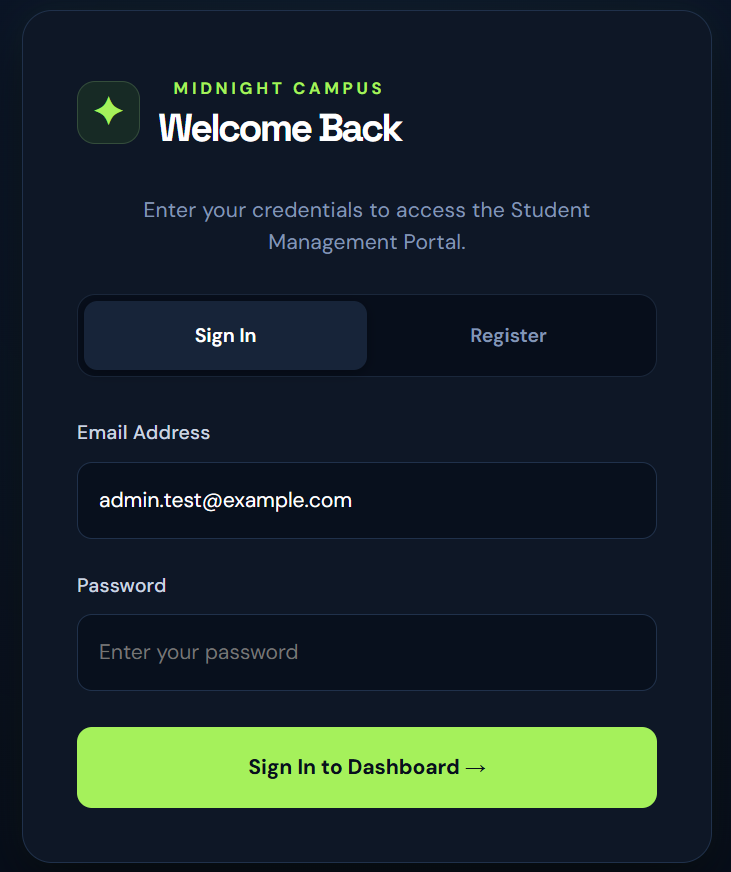
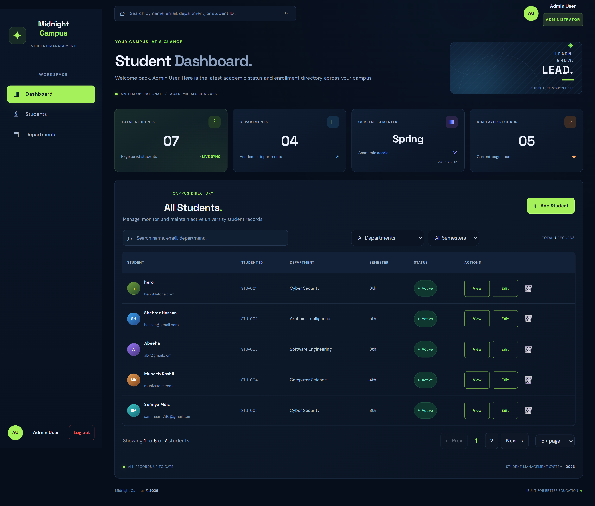
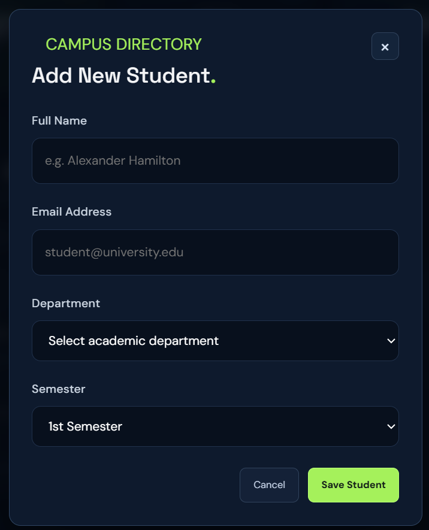
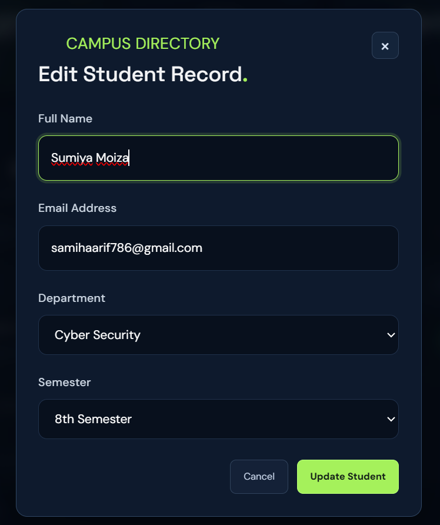
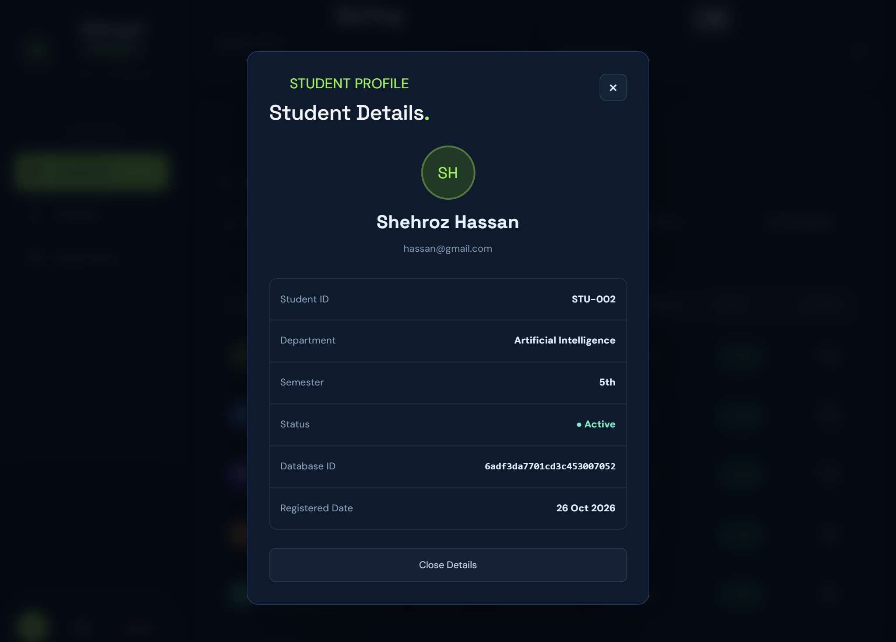
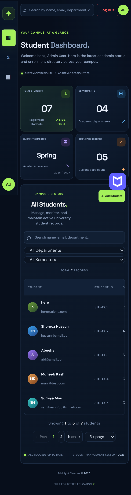

# Midnight Campus — Student Management System

##  Project Title
**Midnight Campus — Full-Stack Student Management System**

---

##  Project Description
**Midnight Campus** is a comprehensive, production-ready Student Management Web Application developed to simplify and modernize university academic record-keeping. The platform provides an intuitive, high-performance interface for managing student enrollments, tracking departmental distributions, and viewing academic profiles in real time.

Built on the modern **MERN architecture (React 19 + Node.js/Express + MongoDB Atlas)** with **Vite**, the application features strict Role-Based Access Control (Admin vs. Student/Viewer), JSON Web Token (JWT) session persistence, multi-criteria filtering, instant search, responsive design, and robust data persistence in MongoDB cloud database.

---

##  Technologies Used

### Frontend
- **React 19**: Modern component architecture, state hooks, and optimized rendering.
- **Vite 8**: Next-generation frontend build tooling and blazing-fast development server with HMR.
- **CSS3 / Modern CSS**: Custom Midnight Campus dark design system with CSS Grid, Flexbox, CSS Variables, and responsive `@media` breakpoints (no heavy third-party CSS libraries).

### Backend
- **Node.js**: Asynchronous event-driven JavaScript runtime environment.
- **Express 5**: Fast, minimalist REST API web framework.
- **Mongoose 9**: Object Data Modeling (ODM) library for MongoDB validation and querying.
- **CORS & Dotenv**: Cross-Origin Resource Sharing handling and environment variable isolation.

### Database
- **MongoDB Atlas**: Highly scalable, cloud-hosted NoSQL document database providing permanent student and user record storage.

### Security & Authentication
- **JSON Web Tokens (`jsonwebtoken`)**: Stateless token-based user authentication and route authorization.
- **Bcrypt.js (`bcryptjs`)**: Cryptographic one-way password hashing (salt rounds: 12) for secure credential storage.
- **Admin Security Key Verification**: Protected administrative account registration.

---

##  Website Features

### 1.  Secure Authentication & Role-Based Access
- **Dual Tab Interface**: Seamlessly switch between **Sign In** and **Registration**.
- **Role-Based Control**:
  - **Administrator (`admin`)**: Authorized for full student CRUD operations (Add, Edit, Delete).
  - **Student / Viewer (`user`)**: Read-only directory access (View records, search, filter, view details).
- **Admin Authorization**: Administrator registration is protected by a secure system setup key (`ADMIN_SETUP_KEY`).
- **Session Persistence**: Stored JWT tokens are validated against `/api/auth/me` on browser refresh, keeping users logged in securely.
- **Graceful Logout**: Instantly flushes local tokens and resets session state.

### 2.  Student CRUD Operations
- **Add Student**: Clean modal form with strict validation for Full Name, Email, Department, and Semester (1st–8th).
- **Edit Student**: Pre-fills existing data into form controls and updates records in MongoDB in real time.
- **Delete Student**: Permanent database deletion guarded by a safety confirmation dialog.
- **View Full Details**: Dedicated profile card displaying Student ID (`STU-001`), database `_id`, status, and registration timestamp.

### 3.  Live Search & Multi-Criteria Filtering
- **Instant Search**: Real-time filtering matching student name, email, department, or student ID.
- **Department Filter**: Filter students across Computer Science, Software Engineering, IT, AI, Cyber Security, and Data Science.
- **Semester Filter**: Quick filter from 1st to 8th semester.
- **One-Click Reset**: Instant reset button to clear all active filters and return to default view.

### 4.  Dashboard & Campus Statistics
- **Total Students Counter**: Live metric reflecting permanent MongoDB records.
- **Active Departments**: Distinct count of campus departments.
- **Academic Session Badge**: Current academic year and active semester indicator.
- **Displayed Records Count**: Dynamic counter synchronized with active pagination and filters.

### 5.  Pagination System
- Server-synchronized pagination controls.
- Previous / Next buttons and direct page number selection.
- Configurable page size dropdown (5, 10, 20, 50 rows per page).

### 6.  Form Validation & Feedback
- Real-time inline validation highlighting missing or malformed inputs.
- Animated non-blocking Toast notifications for all events (Success, Error, Info).
- Dynamic loading spinners for authentication and database transactions.
- Fully responsive design tailored for mobile phones, tablets, and widescreen desktop monitors.

---

##  Project Structure

```text
student-management-system/
│
├── backend/
│   ├── middleware/
│   │   └── auth.js           
│   ├── models/
│   │   ├── Student.js         
│   │   └── User.js            
│   ├── routes/
│   │   ├── auth.js           
│   │   └── students.js        
│   ├── .env.example            
│   ├── package.json          
│   └── server.js             
│
├── frontend/
│   ├── public/              
│   ├── src/
│   │   ├── assets/            
│   │   ├── services/
│   │   │   └── api.js        
│   │   ├── App.css         
│   │   ├── App.jsx           
│   │   ├── index.css          
│   │   └── main.jsx           
│   ├── index.html              
│   ├── package.json            
│   └── vite.config.js          
│
├── Screenshots/                
├── .gitignore                  
├── README.md                   
└── report.pdf                 
```

---

##  Screenshots

### 1. Authentication Portal (Sign In & Register)
> Dual-mode authentication card supporting Login and Administrator / Student registration.


### 2. Main Dashboard & Statistic Cards
> Overview of campus statistics, active semester, and student directory toolbar.


### 4. Add / Edit Student Modal
> Form validation modal for inserting or updating student records in MongoDB.



### 5. Student Details Profile View
> Expanded profile modal displaying student ID, database ID, and registration date.


### 6. Mobile Responsive View
> Compact layout with mobile navigation and horizontal scrolling table.


---

##  Instructions for Running the Website

### Prerequisites
Make sure you have installed on your system:
- **Node.js** (v18.0.0 or higher): [Download Node.js](https://nodejs.org/)
- **npm** (comes bundled with Node.js)
- An active internet connection (to connect to MongoDB Atlas)

---

### Step 1: Start the Backend Server

1. Open your terminal and navigate to the `backend` directory:
   ```bash
   cd backend
   ```

2. Install dependencies (if not already installed):
   ```bash
   npm install
   ```

3. Verify or configure your `backend/.env` file:
   ```env
   PORT=5000
   MONGODB_URI=mongodb+srv://<username>:<password>@cluster0.eofyyfo.mongodb.net/
   JWT_SECRET=your_jwt_secret_key_here
   ADMIN_SETUP_KEY=your_admin_secret_key_here
   ```

4. Start the backend development server:
   ```bash
   npm run dev
   ```
   *Expected output:*
   ```text
   Midnight Campus Server running on http://localhost:5000
   MongoDB connected successfully!
   ```

---

### Step 2: Start the Frontend Client

1. Open a **second** terminal and navigate to the `frontend` directory:
   ```bash
   cd frontend
   ```

2. Install dependencies:
   ```bash
   npm install
   ```

3. Start the Vite development server:
   ```bash
   npm run dev
   ```
   *Expected output:*
   ```text
   VITE v8.3.4  ready in 250 ms
   ➜  Local:   http://localhost:5173/
   ```

4. Open your web browser and visit:
   ```
   http://localhost:5173
   ```


